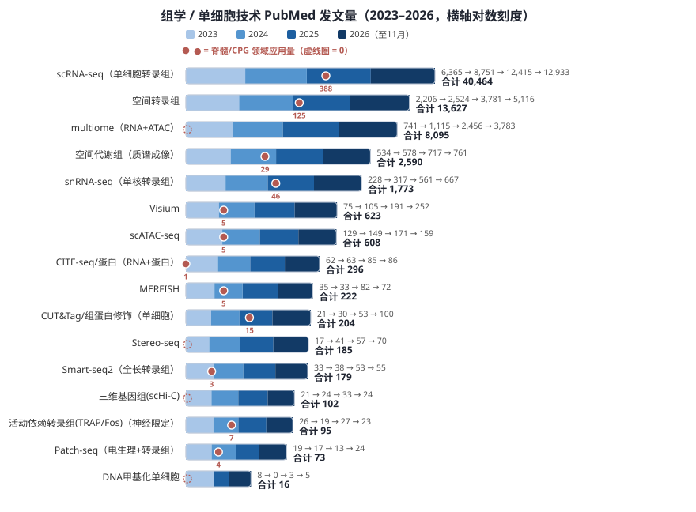
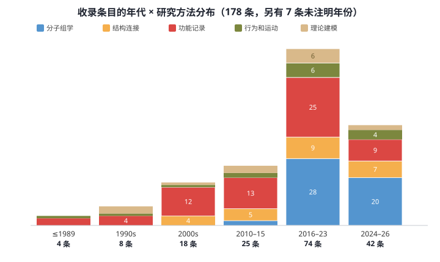
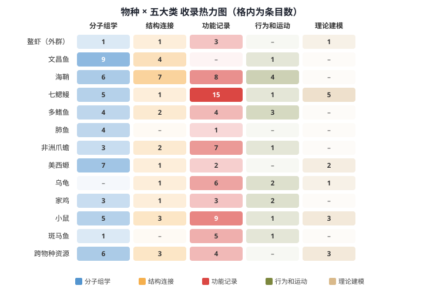
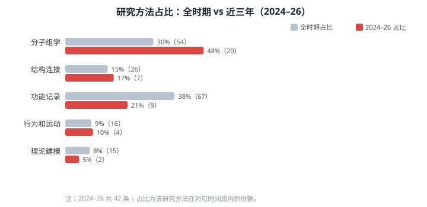
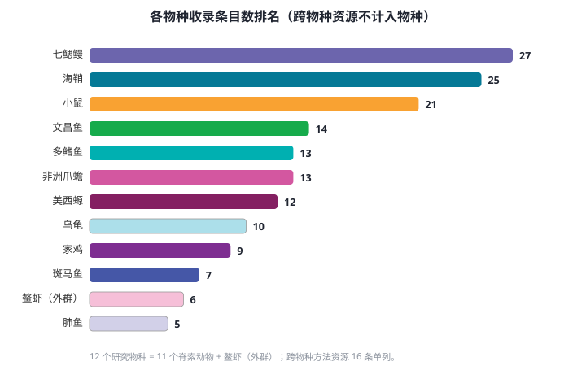

# Spinal Cord / CPG Literature-Data Database (Chordata)

A curated literature & open-data catalog for spinal cord / motor neuron / CPG research across **11 chordate species + 1 outgroup**, built for tracing the evolution of locomotor circuit architecture.

> **📊 数据库总量：相关文章 / 数据资源 / 网站共 178 条；其中 63 条带公开数据（每个数据项附有相关研究的文章 / 数据详情，占 35%）。**

**Two entry points / 两个入口：**

1. **[Interactive database (main page)](https://3417534739.github.io/spinal-cpg-db/)** — `index.html`：网络图 + 全部条目 + 自动评分 + DOI/PMC/数据链接
2. **[Notebooks index](notebooks/README.md)** — 每个带公开数据的数据项附有对应研究的详情 notebook（内含 EN 标题 / 中文摘要 / Highlights / 数据页原文）

**English / 中文双语说明见下。**

## Species covered

Outgroup: *Crayfish (Procambarus)*
Chordata (11 species):
- Cephalochordata — *Branchiostoma* (Amphioxus)
- Tunicata — *Ciona*
- Cyclostomata — *Petromyzon* (Sea lamprey)
- Actinopterygii — *Polypterus*, *Protopterus* (Lungfish)
- Amphibia — *Ambystoma* (Axolotl), *Xenopus*
- Sauropsida — *Testudines* (Turtle), *Gallus* (Chicken)
- Mammalia — *Mus* (Mouse)
- plus *Danio* (Zebrafish) as a modern CPG model

即 **12 个研究物种**（11 个脊索动物 + 鳌虾外群）。另有 16 条**跨物种方法资源**单列统计，**不计入物种**。

## 组学技术生态（数据来自 PubMed 官方检索计数）

**读图**：scRNA-seq 是绝对主流且持续放量（四年 40,464 篇，2026 年前 11 个月已达 12,933 篇）；空间转录组（13,627）与单细胞多组学（8,095）居第二梯队，增速最陡；Stereo-seq 四年 185 篇、逐年抬升（17 → 41 → 57 → 70）；单细胞 CUT&Tag（204）与 CITE-seq（296）稳步上升；Patch-seq 四年 73 篇、2023 年后回落，进入成熟整合期。红色对照行是**领域体量**：脊髓×单细胞四年 541 篇，而脊髓×CPG 仅 116 篇；**每条上的红点 = 该技术四年在脊髓/CPG 领域的应用量**——scRNA-seq 已有 388 篇落地、空间转录组 125 篇，而 Stereo-seq 全网 185 篇却为 0（虚线圈），scHi-C、DNA 甲基化同样为 0，Patch-seq 仅 4 篇。技术总量与领域落地之间的落差，就是本库要填的空隙。

**技术分层总览**（分子组学按"读出层"金字塔逐层叠加读出维度）：

- **转录组主线**：bulk RNA-seq · scRNA-seq · snRNA-seq · Smart-seq2（全长）· 空间转录组（Stereo-seq / Visium / MERFISH）
- **活动依赖转录组**：TRAP-seq · FosTRAP——只读"正在放电/被激活"的神经元，是 CPG 招募研究的直接武器
- **+ 开放染色质**：10x Multiome · SHARE-seq · SNARE-seq · sci-CAR → 同时获得 RNA + 染色质可及性 + TF motif + 基因调控网络
- **+ 组蛋白修饰**：scCUT&Tag · Paired-Tag · nano-CUT&Tag（H3K27ac=活性 enhancer，H3K4me3=活跃启动子，H3K27me3=抑制性，H3K4me1=poised enhancer）
- **+ 蛋白**：CITE-seq · REAP-seq · Feature Barcode；**RNA+ATAC+蛋白**：TEA-seq · DOGMA-seq · ASAP-seq
- **+ DNA 甲基化**：scM&T-seq · scNMT-seq · scTrio-seq；**三维基因组**：scHi-C · enhancer–promoter contact / TAD 分析
- **代谢组**：bulk / 单细胞 / 空间代谢组（LC-MS/MS、质谱成像）——神经递质与能量代谢
- **功能配对**：Patch-seq（电生理+形态+转录组三合一）

| 技术 | PubMed 2023 / 24 / 25 / 26* | 四年合计 | 脊髓/CPG 领域应用量 | 众数期刊（发文最多）· IF | 顶刊最高 IF | 对 CPG / 运动神经回路 / 脊髓演化研究的价值 |
|---|---|---|---|---|---|---|
| scRNA-seq | 6,365 / 8,751 / 12,415 / 12,933 | **40,464** | **388** | Nat Commun · 15.7 | Nature · 48.5 | 跨物种脊髓细胞类型同源比对的底座——把海鞘、七鳃鳗、小鼠的运动神经元放上同一棵演化树 |
| 空间转录组 | 2,206 / 2,524 / 3,781 / 5,116 | **13,627** | **125** | Nat Commun · 15.7 | Nat Methods · 32.1 | 保住背腹轴与节段坐标——CPG 神经元的位置信息正是解离数据丢掉的部分 |
| 单细胞多组学（RNA+ATAC） | 741 / 1,115 / 2,456 / 3,783 | **8,095** | **60** | Nat Commun · 15.7 | Nature · 48.5 | 同一细胞 RNA+ATAC 配对；非模式物种参考基因组弱时尤其有用 |
| 空间代谢组（质谱成像） | 534 / 578 / 717 / 761 | **2,590** | **29** | —（未单列） | — | 神经递质与能量代谢的空间分布——CPG 连续放电的代谢代价与恢复 |
| snRNA-seq | 228 / 317 / 561 / 667 | **1,773** | **46** | —（未单列） | — | 对冷冻 / 致密组织友好，成体脊髓 atlas 的主力方案 |
| Visium | 75 / 105 / 191 / 252 | **623** | **5** | Nat Commun · 15.7 | Nat Methods · 32.1 | 低门槛平台，适合物种间脊髓切片的快速空间对照 |
| scATAC-seq | 129 / 149 / 171 / 159 | **608** | **5** | Nat Commun · 15.7 | Nat Methods · 32.1 | 顺式调控演化——运动神经元表型的"接线改动"大多写在增强子里 |
| CITE-seq（RNA+蛋白） | 62 / 63 / 85 / 86 | **296** | **1** | —（未单列） | — | marker mRNA 与蛋白丰度解耦的校准层，避免"有转录无翻译"的误判 |
| MERFISH | 35 / 33 / 82 / 72 | **222** | **5** | Nat Commun · 15.7 | Cell · 42.5 | 靶基因 panel 单分子定位，可逐个验证 CPG 基因表达的空间梯度 |
| CUT&Tag（组蛋白修饰，单细胞） | 21 / 30 / 53 / 100 | **204** | **15** | —（未单列） | — | 区分"marker 表达"与"调控程序真正开启"——H3K27ac/H3K4me3 才是 enhancer/启动子工作的证据 |
| Stereo-seq | 17 / 41 / 57 / 70 | **185**（官方累计 463） | **0** ⚠️ | Nat Commun · 15.7 | Cell · 42.5 | cm 级视场 + 亚细胞分辨率，可整段脊髓连续切片做 3D 重建，非模式物种大图谱利器 |
| Smart-seq2（全长） | 33 / 38 / 53 / 55 | **179** | **3** | —（未单列） | — | 全长覆盖+高灵敏度，非模式物种（无参考注释）从头注释的优选 |
| scHi-C（三维基因组） | 21 / 24 / 33 / 24 | **102** | **0** ⚠️ | —（未单列） | — | enhancer–promoter 物理接触与 TAD 结构——调控演化从"序列"到"空间构象" |
| 活动依赖转录组（TRAP/Fos，神经限定） | 26 / 19 / 27 / 23 | **95** | **7** | —（未单列） | — | **只读运动时实际被招募的神经元**——游泳/爬行前后 CPG 招募图谱的直接手段 |
| Patch-seq | 19 / 17 / 13 / 24 | **73** | **4** | Neuron · 17.0 | Nature · 48.5 | **电生理 + 形态 + 转录组三合一**，把离子通道表达谱直接锚到 CPG 节律 / 突触属性上——"基因 → 细胞功能"的最短路径 |
| scM&T / scNMT（DNA 甲基化） | 8 / 0 / 3 / 5 | **16** | **0** ⚠️ | —（未单列） | — | 甲基化+转录组同细胞配对，细胞状态的表观遗传"记忆"层 |

**领域对照（红色行）**：CPG 全领域（TIAB 检索）四年 380 篇（101 / 102 / 86 / 91，年发文量不增反降）；其中脊髓×CPG 仅 **116 篇**（42 / 22 / 23 / 29）；脊髓×单细胞 541 篇（110 / 103 / 170 / 158）且翻倍式增长。也就是说：**脊髓组学在爆发，但组学技术与 CPG 问题的交叉仍然稀薄**——本库正位于这个交叉点上。

表注：发文量 = PubMed 官方 E-utilities 检索计数（2026-11-06 查询；*2026 年数据截至 11 月）。众数期刊 = 2023–25 该技术论文发表最多的期刊（在 14 本高影响力期刊范围内检索），其 IF 为 2024 JIF（2025-06 发布：Nature 48.5、Science 45.8、Cell 42.5、Nat Biotechnol 41.7、Nat Methods 32.1、Nat Commun 15.7、Cell Res 25.9、Nat Neurosci 20.0、Neuron 17.0、Cell Discov 12.5、Genome Biol 9.4、Dev Cell 8.7、Cell Rep 6.9）；顶刊最高 IF = 该技术在同口径下发文 ≥2 篇的期刊中 IF 最高者。Stereo-seq 官方口径（STOmics，截至 2025-12-31）累计 463 篇、IF>20 的占 20%，蝾螈端脑再生（Science 封面）、猕猴皮层与屏状核 3D 图谱（Cell 封面）、跨物种小脑比较（Science）等脑科学/演化标杆工作均出自该平台。脊髓/CPG 领域对照为 TIAB 标题摘要检索。

**神经元相关技术的特别关注（Patch-seq 等）**：Patch-seq 是唯一把"电生理表型 + 形态 + 转录组"在同一个细胞上配对的技术，对运动回路研究价值最直接——CPG 的节律发生与突触整合属性（如 dIN 的电耦合、运动神经元的输入电阻）只有靠这种配对才能落到基因层面。其发文量虽小（四年 73 篇，2026 年回升至 24 篇）但顶刊浓度高（Nature / Science 各 2 篇），主发 Neuron（IF 17.0）与 Nat Commun；当前价值在于与 atlas 项目整合（Allen Institute 的高保真电生理+形态+转录组规模化管线即代表，本库已收录其条目）。同属"神经元功能×分子"路线的还有活动依赖转录组（TRAP/Fos）与单细胞电生理驱动的转录组分型（如七鳃鳗 reticulospinal 细胞分型），是我们库"功能记录"类与"分子组学"类之间的天然桥梁。

**我们已收集的组学数据与空白**：按条目描述关键词自动归类（可重叠），178 条中组学技术相关约 40 条——scRNA-seq 18、ATAC/染色质 10、空间转录组 9、多组学配对 6、snRNA-seq 5、活动依赖/神经元激活 4（美西螈·乌龟·爪蟾）、Patch-seq 类 3、组蛋白修饰 3（跨物种）、DNA 甲基化 1（跨物种）；非组学侧为行为/运动学 28、连接组/形态重建 8、基因组组装 7。**对照上面的技术分层，空白清晰**：① 平台级空间数据（Visium / MERFISH）0 条；② 蛋白层面（CITE-seq 等）0 条、三维基因组（Hi-C）0 条、代谢组 0 条、Smart-seq2 全长方案 0 条；③ 单独的 scATAC-seq（不与多组学捆绑）稀缺，顺式调控演化证据薄弱；④ Patch-seq 类在 CPG 核心物种（七鳃鳗、蝌蚪、龟胚胎）几近空白；⑤ 活动依赖转录组仅 4 条且无 TRAP-seq 级公共数据——而"运动前后 CPG 招募了谁"正是本库最该回答的问题。建议补录优先级：七鳃鳗/蝌蚪脊髓的 Patch-seq 或电生理-转录组配对数据 > 运动诱导的 Fos/TRAP 激活图谱 > Visium/MERFISH 脊髓切片 > 单独 scATAC > CUT&Tag enhancer 目录。这些层级数据共同支撑四个核心问题：判断 LMC-like 与 CPG 模块是否存在、区分"marker 表达"与"调控程序真正开启"、比较变态/再生/发育阶段的模块切换、做跨物种细胞类型与调控网络同源分析。

## Dashboard at a glance

### 1 · 年代 × 研究方法分布（历史趋势）

**结论（历史趋势）**：收录条目随年代显著加速——1973–2009 合计仅 30 条，2010–15 增至 25 条，2016–23 达到峰值 74 条，2024–26 三年即 42 条，占全库近四分之一。研究方法构成上，功能记录（电生理/成像类）与分子组学（测序/图谱类）始终是两大主线；2016 年以后分子组学占比明显抬升，反映单细胞/空间组学技术在脊髓与运动神经元研究中的普及。

### 2 · 物种 × 研究方法 热力图

**结论（物种覆盖）**：七鳃鳗（27）、海鞘（25）、小鼠（21）是收录最厚的三个物种——七鳃鳗以功能记录（15）为绝对主力，配理论建模（5），体现经典 CPG 电生理+建模传统；海鞘的结构连接（7）与功能记录（8）最厚，连接组资源突出；小鼠则以功能记录（9）为主。相反，肺鱼（5）、鳌虾外群（6）、斑马鱼（7）的覆盖偏窄——肺鱼 5 条中 4 条集中于分子组学，其余类别近乎空白，是后续文献补录的优先方向。

### 3 · 近三年热点（2024–26 vs 全时期）

**结论（近三年热点）**：近三年（42 条）的热点明显向**分子组学**集中——占 2024–26 新增条目的 48%（20 条），远高于其全时期基线 30%，对应大量单细胞/空间转录组 atlas 与多组学资源的爆发；功能记录类份额从 38% 回落到 21%（经典电生理产出放缓），结构连接类保持稳定略升（17% vs 15%）。理论建模近三年仅 2 条，仍是明显短板；行为和运动 4 条，其中闭环/机器人实验范式开始出现，值得追踪。

### 4 · 物种收录完备性排名

**结论（完备性）**：条目数排名为 七鳃鳗 27 > 海鞘 25 > 小鼠 21 > 文昌鱼 14 > 非洲爪蟾 / 多鳍鱼 13 > 美西螈 12 > 乌龟 10 > 家鸡 9 > 斑马鱼 7 > 鳌虾 6 > 肺鱼 5。头部三个物种贡献了全库约 41% 的条目；尾部的肺鱼、鳌虾、斑马鱼多依赖早期经典文献与少量组学资源，公开数据可得率最低——这与"进化节点越关键、数据反而越稀缺"的总体格局一致。

## What's inside

| File | Content |
|---|---|
| `index.html` | Interactive single-file database: 178 entries, force-directed network graph, word-bank auto-relevance scoring (0–6), research-object filter, DOI / PMC / data-page links per entry |
| `INVENTORY.md` | Full audit: open-data coverage per species, reasons for unavailability, corresponding-author emails, link-fix log |
| `DATABASES.md` | ~100 neuroscience / model-organism data repositories, organized by data type |
| `WORDBANK.md` | Curated domain word bank (CPG / spinal cord / cell identity / electrophysiology / …) used for auto-scoring and search |
| `data/entries.js` | All 178 entries as loadable JS |

## Data coverage (2026-11-06)

- **178 entries**（相关文章 / 数据资源 / 网站），spanning 1973–2026
- **63 entries (35%)** with direct open-data links (GEO / ArrayExpress / DANDI / CRCNS / Figshare / Zenodo / GitHub / official portals) — 每个数据项附有相关研究的文章 / 数据详情 notebook
- Every entry has at least one working link (DOI / PMC / open PDF / data page)
- Relevance scoring is computed from an explicit keyword rule bank (object / process / evidence dimensions) — no hand-tuned stars

---
中文说明：本库汇总 **12 个研究物种**（11 个脊索动物 + 鳌虾外群；跨物种方法资源不计入物种）的脊髓/运动神经元/CPG 文献与公开数据资源，共 **178 条**，其中 **63 条**带公开数据。每条含 DOI/PMC/数据页链接、词库自动相关度评分（对象/过程/证据三维）、研究对象过滤。`INVENTORY.md` 含逐条开放数据可得性审计与通讯作者邮箱。
